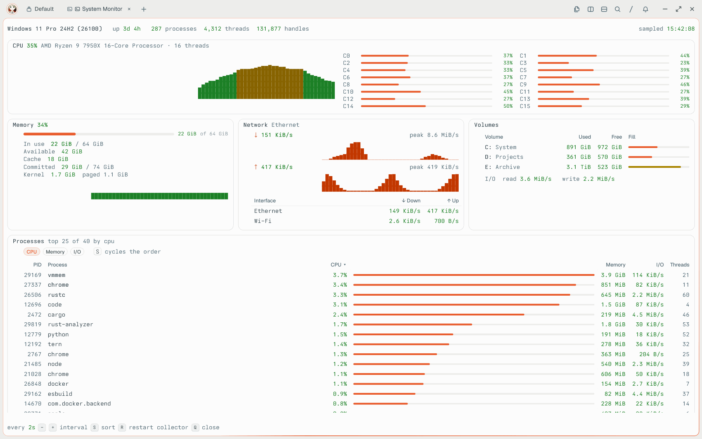
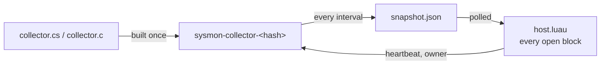

# System Monitor for Tern

[](https://github.com/hastecraft/tern-sysmon/actions/workflows/ci.yml)
[](LICENSE)

A btop-style system monitor for [Tern](https://stencil.so/tern), drawn as a
**native Tern block** rather than a terminal program: per-core CPU with a
history graph, memory, network, volumes and disk I/O, and every process with
its CPU, memory, I/O and threads. Windows, macOS and Linux.



<sub>Screenshot with sample data.</sub>

## Install

```sh
tern plugin install github.com/hastecraft/tern-sysmon
```

Then open one from the palette with **New System Monitor block**, or press
<kbd>Alt</kbd>+<kbd>Shift</kbd>+<kbd>M</kbd> (<kbd>⌥</kbd><kbd>⇧</kbd><kbd>M</kbd>
on macOS) to open one beside the focused pane, or focus the one already open.

On first open the plugin builds its small native collector from source, once:

| OS | Needs | Built with |
| --- | --- | --- |
| Windows 10/11 | nothing | the C# compiler that ships with Windows (.NET Framework 4.x `csc.exe`) |
| macOS | Xcode Command Line Tools (`xcode-select --install`) | `cc` |
| Linux | a C compiler (`sudo apt install gcc`, `dnf install gcc`, `pacman -S gcc`, …) | `cc` |

If the compiler is missing, the block says so and what to install; press
<kbd>R</kbd> once it is there. No binaries ship in this repository: everything
that runs is built from the source you can read here.

**Remote hosts.** Blocks run on the host whose panes they serve, so the
monitor shows the machine it is installed on. To watch a remote host, install
the plugin there too (`tern plugin install …` in a pane on that host).

## Use

| Key | Action |
| --- | --- |
| <kbd>S</kbd> / <kbd>Tab</kbd> | order processes by CPU → memory → I/O (or click the tabs) |
| <kbd>-</kbd> / <kbd>+</kbd> | sample faster / slower, 1 s to 10 s (remembered) |
| <kbd>R</kbd> | restart the collector now (also skips a retry wait) |
| <kbd>Q</kbd> | close the block |

| Card | Shows |
| --- | --- |
| Header | OS and version, uptime, processes, threads, handles (Windows) or open files, last sample time. No host name, so screenshots stay anonymous |
| CPU | total, per-core meters, a fixed-scale 0–100 % history graph |
| Memory | in use, available, cache; committed and kernel pools (Windows), swap and kernel (Linux), swap and wired (macOS); a history graph |
| Network | total down/up with auto-scaled graphs and their peaks, the busy interfaces |
| Volumes | used, free and fill per local volume; total disk read/write |
| Processes | top 25 by CPU, memory or I/O: PID, CPU as % of the whole machine, resident memory, I/O rate, threads |

The layout follows the pane: CPU and processes take full rows; memory,
network and volumes sit three, two or one to a row as the pane narrows.
Graphs keep the newest sample at the right edge.

**Themes.** Every color comes from Tern's own surface tokens, so the monitor
follows whatever theme is active, light or dark, without configuration.

## How it works



- One collector runs while **any** monitor block is open, at low priority,
  and writes `snapshot.json` atomically every interval. It reads the kernel
  directly:
  - **Windows:** `NtQuerySystemInformation` (per-core times and every
    process, services included, without elevation), `GlobalMemoryStatusEx`,
    `GetPerformanceInfo`. No performance counters, so it works on machines
    whose counter registry is broken.
  - **Linux:** `/proc` and `/sys`.
  - **macOS:** Mach host statistics, `libproc`, IOKit and `sysctl`.
- `host.luau` polls the snapshot, keeps the history and draws every open
  block. It writes a `heartbeat` while blocks are open; the collector exits
  when the heartbeat goes stale or when `owner` names a newer collector (a
  plugin reload starts one), so it never outlives Tern.
- If the collector dies, the block keeps the last data on screen, says why,
  and retries with backoff (5 s, 10 s, 20 s … 60 s).
- The build is named after a hash of its source, so an updated plugin
  rebuilds on its own.

It makes no network requests. Everything it writes stays in the plugin's data
folder (`tern.plugin.data`): the built collector, `snapshot.json`,
`heartbeat`, `owner`, `collector.err` and `kv.json` (the interval).

### Cost

Measured at the default 2 s interval:

| | CPU per sample | Resident memory |
| --- | --- | --- |
| Windows 11, ~320 processes | ~7 ms (0.36 % of one core) | ~20 MB |
| Linux (Ubuntu 22.04), ~30 processes | ~0.6 ms (0.03 % of one core) | ~2 MB |

## Limitations

- Tern does not yet tell plugin blocks their pane size (`cx.cols`/`cx.rows`
  stay 80×24 and `resize` does not fire), so the layout is done in CSS.
- History lives in memory: it starts over when the plugin reloads.
- Processes the OS hides from your user are listed without some figures: on
  macOS, other users' processes have no CPU or I/O; on Linux, per-process I/O
  is readable only for your own processes.
- Process I/O on Windows and Linux counts every read and write (files,
  pipes, sockets), not only disk; macOS reports disk I/O.

## Development

```sh
git clone https://github.com/hastecraft/tern-sysmon
tern plugin link tern-sysmon      # use it in place; saving any file reloads it
tern plugin types tern-sysmon     # writes tern.d.luau for luau-lsp
luau-lsp analyze --definitions:@tern=tern-sysmon/tern.d.luau tern-sysmon/host.luau tern-sysmon/window.luau
```

| Windows 11, ~320 processes | ~7 ms (0.36 % of one core) | ~24 MB |
keep build output and screenshots elsewhere, and note that a save with a
syntax error ends every open monitor block until it is fixed.

`ci/validate.py` runs a built collector the way the plugin does and checks
the protocol and the numbers (a child process spinning one core must show up
at one core's share of the machine). CI runs it on Linux, macOS (Apple
silicon and Intel) and Windows:

```sh
cc -O2 -o /tmp/sysmon-collector collector.c                      # Linux
cc -O2 -o /tmp/sysmon-collector collector.c -framework IOKit -framework CoreFoundation  # macOS
python3 ci/validate.py /tmp/sysmon-collector
```

| File | Role |
| --- | --- |
| `plugin.toml` | the manifest: id `sysmon`, block `monitor` |
| `host.luau` | the block: collector lifecycle, polling, history, the view |
| `window.luau` | the palette command and the key bind |
| `collector.cs` | the Windows sampler (C# 5, in-box compiler) |
| `collector.c` | the Linux and macOS sampler (C99) |
| `sysmon.css` | the responsive layout, core meters and graph colors |
| `ci/validate.py` | the collector test CI runs |

## License

[MIT](LICENSE)
