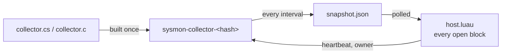

# System Monitor for Tern

[](https://github.com/hastecraft/tern-sysmon/actions/workflows/ci.yml)
[](LICENSE)

A btop-style system monitor for [Tern](https://stencil.so/tern), drawn as a
**native Tern block** rather than a terminal program. One page shows it all:
CPU per thread, GPUs, memory, network, disk I/O, volumes and every process,
with history charts. Windows, macOS and Linux.


## Install

Needs **Tern 0.9.9 or newer** (it draws with the charts, tables, stats and
settings sheet that release added).

```sh
tern plugin install github.com/hastecraft/tern-sysmon
```

Open one from the palette with **New System Monitor block**, or press
<kbd>Alt</kbd>+<kbd>Shift</kbd>+<kbd>M</kbd> (<kbd>⌥</kbd><kbd>⇧</kbd><kbd>M</kbd>
on macOS) to open one beside the focused pane, or focus the one already open.

On first open the plugin builds its small native collector from source, once:

| OS | Needs | Built with |
| --- | --- | --- |
| Windows 10/11 | nothing | the C# compiler that ships with Windows (.NET Framework 4.x `csc.exe`) |
| macOS | Xcode Command Line Tools (`xcode-select --install`) | `cc` |
| Linux | a C compiler (`sudo apt install gcc`, `dnf install gcc`, `pacman -S gcc`, …) | `cc` |

If the compiler is missing, the block says so and what to install; press
<kbd>R</kbd> once it is there. No binaries ship in this repository: everything
that runs is built from the source you can read here.

**Remote hosts.** Blocks run on the host whose panes they serve, so the
monitor shows the machine it is installed on. To watch a remote host, install
the plugin there too (`tern plugin install …` in a pane on that host).

## Use

| Panel | Shows |
| --- | --- |
| Head | OS and version, uptime, threads, handles (Windows) or open files, sample time, collector status. No host name, so screenshots stay anonymous |
| Headline numbers | CPU, memory, network and disk at a glance; amber or red when they need attention |
| CPU | a 0–100 % history line with a busy mark, and a bar per thread |
| GPU | each GPU's busy share over time and its dedicated memory |
| Memory | in use and available, cache, committed and kernel pools (Windows), swap and kernel (Linux), swap and wired (macOS), a history area |
| Network | down and up over time, the busiest interfaces |
| Disk I/O | read and write over time |
| Volumes | free space and fill per local volume |
| Processes | sortable by any column, a CPU trend per process, a status dot (idle, running, a full core, half the machine); select one for its details and **End process** |

Click a column head to sort by it, or use the CPU / Memory / I/O switch.
Right-click a process for **End process…** and **Copy PID**. Ending a process
always asks first.

| Key | Action |
| --- | --- |
| <kbd>↑</kbd> <kbd>↓</kbd> (<kbd>J</kbd> <kbd>K</kbd>) | select a process |
| <kbd>X</kbd> / <kbd>Delete</kbd> | end the selected process (asks; <kbd>Enter</kbd> confirms, <kbd>Esc</kbd> cancels) |
| <kbd>S</kbd> | sort by CPU → memory → I/O |
| <kbd>-</kbd> / <kbd>+</kbd> | sample faster / slower: 1, 2, 5 or 10 s |
| <kbd>,</kbd> | settings |
| <kbd>R</kbd> | restart the collector (also skips a retry wait) |
| <kbd>Q</kbd> | close the block |

### Settings

<kbd>,</kbd> or the sliders button opens a settings sheet. Changes apply at
once to every open monitor and are kept:

- **Sample every** 1, 2, 5 or 10 s.
- **History**: 60, 120 or 300 samples per chart.
- **Process rows**: 10, 20, 50 or all.
- **Panels**: show or hide the headline numbers, CPU, per-thread bars, GPU,
  memory, network, disk I/O, volumes and processes.

The layout follows the pane: CPU and GPU share the top row, the other panels
sit four, three, two or one to a row as the pane narrows, and processes take
the full width.

**Themes.** The view is built only from Tern's own elements and tones, with no
stylesheet, so it follows whatever theme is active, light or dark.

## How it works



- One collector runs while **any** monitor block is open, at low priority,
  and writes `snapshot.json` atomically every interval. It reads the kernel
  directly:
  - **Windows:** `NtQuerySystemInformation` (per-core times and every
    process, services included, without elevation), `GlobalMemoryStatusEx`,
    `GetPerformanceInfo`, and the D3DKMT statistics Task Manager's GPU page
    reads (any vendor). No performance counters, so it works on machines whose
    counter registry is broken.
  - **Linux:** `/proc` and `/sys`; NVIDIA GPUs through NVML when the driver
    installed it, AMD GPUs through `amdgpu`'s sysfs files.
  - **macOS:** Mach host statistics, `libproc`, IOKit (disks and GPU
    statistics) and `sysctl`.
- `host.luau` polls the snapshot, keeps the history and draws every open
  block. It writes a `heartbeat` while blocks are open; the collector exits
  when the heartbeat goes stale or when `owner` names a newer collector (a
  plugin reload starts one), so it never outlives Tern.
- If the collector dies, the block keeps the last data on screen, says why,
  and retries with backoff (5 s, 10 s, 20 s … 60 s).
- The build is named after a hash of its source, so an updated plugin
  rebuilds on its own.

It makes no network requests. Everything it writes stays in the plugin's data
folder (`tern.plugin.data`): the built collector, `snapshot.json`,
`heartbeat`, `owner`, `collector.err` and `kv.json` (the interval and settings).

### Cost

Measured at the default 2 s interval:

| | CPU per sample | Resident memory |
| --- | --- | --- |
| Windows 11, ~320 processes | ~7 ms (0.36 % of one core) | ~24 MB |
| Linux (Ubuntu 22.04), ~30 processes | ~0.6 ms (0.03 % of one core) | ~2 MB |

## Limitations

- History lives in memory: it starts over when the plugin reloads.
- GPU utilization needs a driver that reports it: Intel GPUs on Linux show
  none, and Apple silicon shares system memory, so it shows no separate VRAM.
- Processes the OS hides from your user are listed without some figures: on
  macOS, other users' processes have no CPU, I/O or thread count (so the
  header's thread total covers your own processes); on Linux, per-process I/O
  is readable only for your own processes.
- Process I/O on Windows and Linux counts every read and write (files,
  pipes, sockets), not only disk; macOS reports disk I/O.

## Development

```sh
git clone https://github.com/hastecraft/tern-sysmon
tern plugin link tern-sysmon      # use it in place; saving any file reloads it
tern plugin types tern-sysmon     # writes tern.d.luau for luau-lsp
luau-lsp analyze --definitions:@tern=tern-sysmon/tern.d.luau tern-sysmon/host.luau tern-sysmon/window.luau
```

A linked plugin reloads about 300 ms after any file in the folder changes, so
keep build output and screenshots elsewhere, and note that a save with a
syntax error ends every open monitor block until it is fixed.

`ci/validate.py` runs a built collector the way the plugin does and checks
the protocol and the numbers (a child process spinning one core must show up
at one core's share of the machine). CI runs it on Linux, macOS (Apple
silicon and Intel) and Windows:

```sh
cc -O2 -o /tmp/sysmon-collector collector.c -ldl                                          # Linux
cc -O2 -o /tmp/sysmon-collector collector.c -framework IOKit -framework CoreFoundation  # macOS
python3 ci/validate.py /tmp/sysmon-collector
```

| File | Role |
| --- | --- |
| `plugin.toml` | the manifest: id `sysmon`, block `monitor` |
| `host.luau` | the block: collector lifecycle, polling, history, settings, the view |
| `window.luau` | the palette command and the key bind |
| `collector.cs` | the Windows sampler (C# 5, in-box compiler) |
| `collector.c` | the Linux and macOS sampler (C99) |
| `ci/validate.py` | the collector test CI runs |

## License

[MIT](LICENSE)
